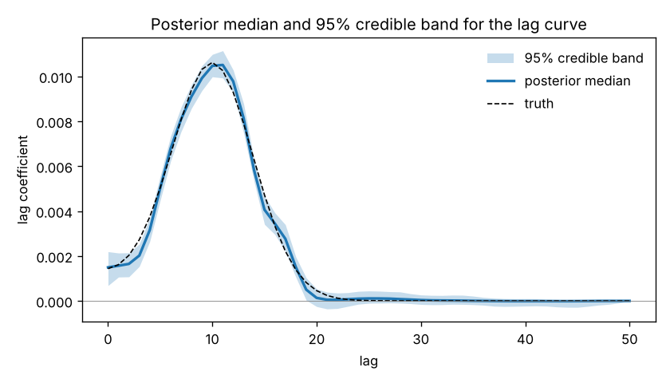
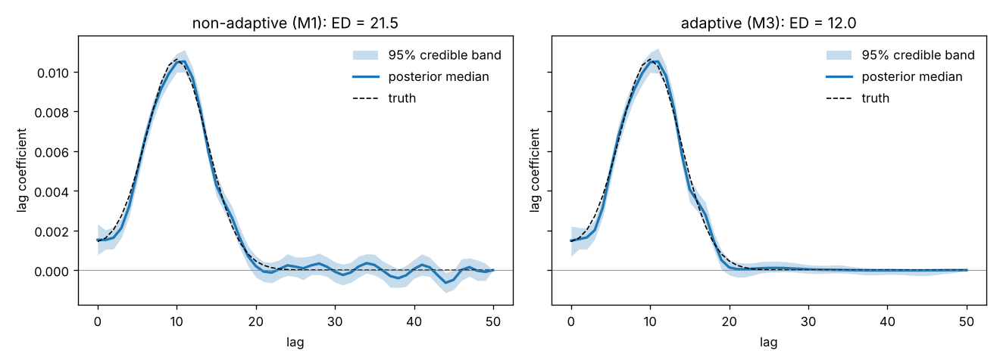
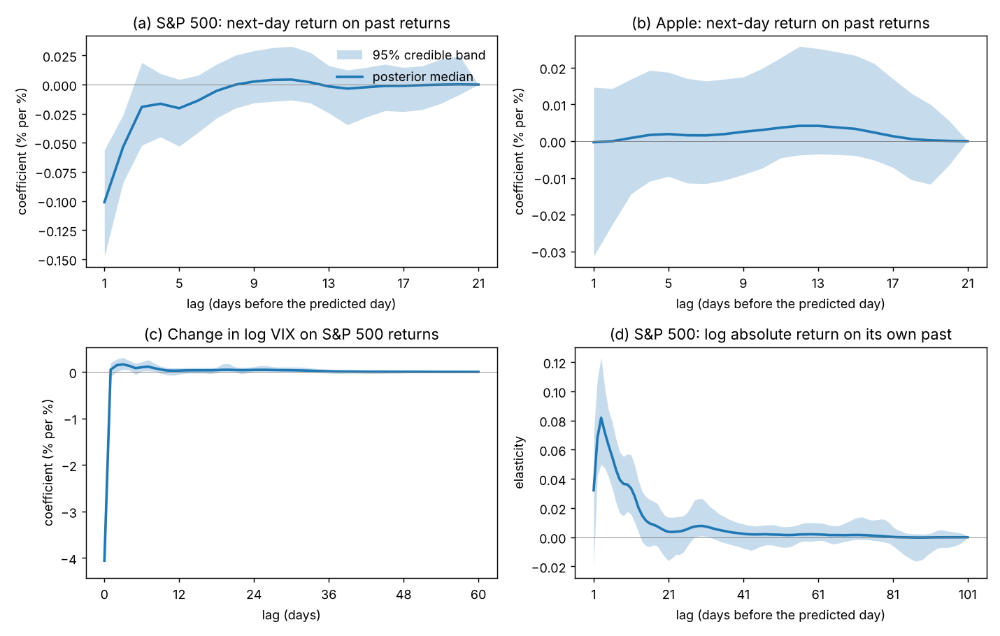
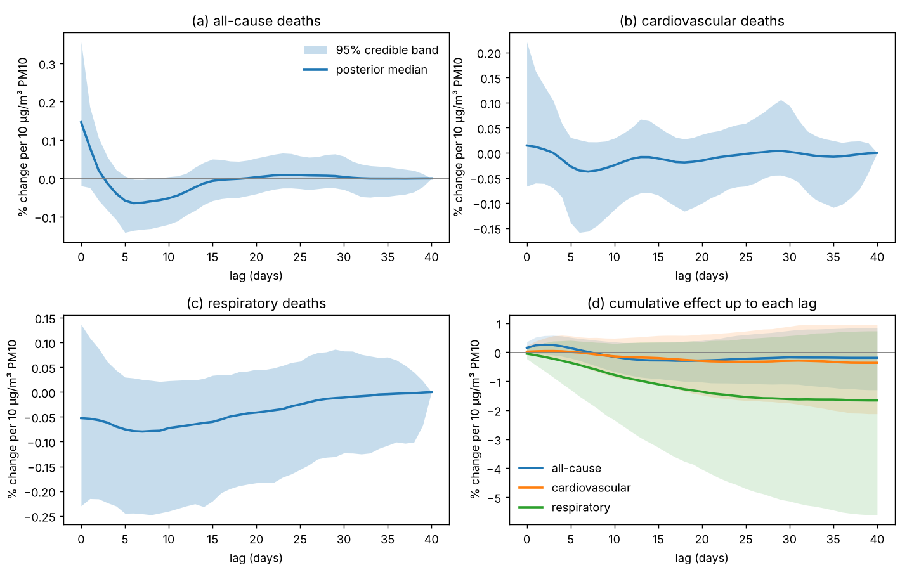
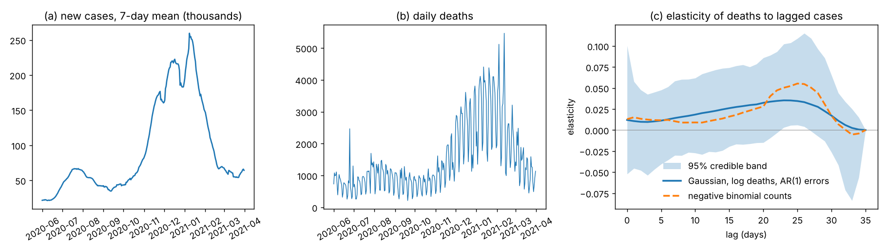

# badlm

Bayesian adaptive distributed lag models in Python.

`badlm` infers the temporally delayed dependence between an exposure series
and a response. It implements the model of

- Rushworth, A. (2018). *Bayesian adaptive distributed lag models.*
  [arXiv:1801.06670](https://arxiv.org/abs/1801.06670). A revised copy of the
  paper source lives in [`paper/`](paper/).

The lag curve is represented by a B-spline basis whose coefficients receive a
first-difference penalty with **lag-varying precision**; the log precisions are
themselves smoothed, so the amount of smoothing adapts to the shape of the curve
and the maximum lag can be chosen generously without overfitting.

This version is a complete rewrite of the original R package. The spline
coefficients are integrated out analytically and the remaining low-dimensional
posterior is sampled with the No-U-Turn Sampler (via NumPyro and JAX), which
removes the funnel between the curve and its smoothing parameters that slowed
the original Gibbs/Metropolis scheme.

## Installation

```bash
pip install git+https://github.com/alastairrushworth/badlm
```

Python 3.10 or later; depends on NumPy, SciPy, JAX, NumPyro and matplotlib.
Optional extras: `pip install "badlm[arviz,pandas]"`.

## Quick start

```python
import numpy as np
from badlm import BADLM, readme_lag_curve, simulate_dlm

# a 'hump' lag curve over 50 lags and data simulated from it
truth = readme_lag_curve(50)
x, y = simulate_dlm(truth, n=500, standardize_x=True, ar_eps=0.0, sd_eps=0.01, seed=2018)

model = BADLM(nlag=50, k=30)               # adaptive model, exact zero constraint at lag 50
model.fit(x, y, samples=1000, warmup=1000, chains=4, seed=1)
print(model.summary())
model.plot(truth=truth)
```



The fitted object exposes the posterior draws of the lag curve on the original
scale (`model.lag_curve_`, shape `(chains, draws, nlag + 1)`) and a set of derived
quantities:

```python
model.lag_curve_summary()        # median and 95% band per lag (to_dataframe() available)
model.cumulative_effect()        # total effect of a unit change in x
model.peak_lag()                 # posterior distribution of the lag with largest effect
model.effective_lag_length()     # lag beyond which the curve is effectively zero
model.effective_df()             # effective degrees of freedom of the fitted curve
model.diagnostics()              # R-hat, bulk ESS, divergent transitions
model.predict(x_new)             # posterior predictive mean / response
model.to_arviz()                 # arviz.InferenceData for further analysis
```

Adaptive versus non-adaptive smoothing on the same data (`tau_model='constant'`
is model M1 of the paper; the default `'rw'` is M3):



## Model options

```python
BADLM(
    nlag=50,                 # maximum lag p
    k=None,                  # B-spline functions; default ceil(2(p + 1)/3)
    tau_model="rw",          # 'rw' | 'basis' | 'monotone' | 'horseshoe' | 'constant'
    end_constraint="zero",   # 'zero' | 'zero_slope' | 'none'
    family="gaussian",       # 'gaussian' | 'poisson' | 'negbin'
    ar1=False,               # AR(1) errors (Gaussian family)
    intercept=True,
    standardize=True,        # internal standardisation; results on the original scale
    sampler="nuts",          # 'nuts' | 'gibbs' | 'laplace'
    priors=Priors(),         # hyperparameters, see badlm.priors.Priors
)
```

**Priors on the log precisions.** `'rw'` is the random walk of the paper with
penalised-complexity (exponential) priors on its scale and on the standard
deviation implied by its level, so the model shrinks towards the non-adaptive
fit unless the data ask for adaptivity, and the precision cannot drift to
numerically meaningless values once the data stop informing it. `'basis'` represents the log precisions with a handful
of B-splines, `'monotone'` forces smoothing to increase with lag, `'horseshoe'`
uses independent local shrinkage of each difference, and `'constant'` is the
non-adaptive model.

**End constraints.** The curve can be forced to zero at the maximum lag, or to
zero with zero slope, by projecting the coefficients onto the constraint null
space; no tuning parameter is involved and the closed-form generalised
determinant used in the likelihood is unchanged.

**Samplers.** `'nuts'` integrates the coefficients out and samples the log
precisions, error variance and AR(1) coefficient with NUTS; each likelihood
evaluation costs O(k^3) irrespective of the series length because only
sufficient statistics are used. Chains start at the Laplace mode and use a
dense mass matrix by default (`dense_mass=False` switches it off). `'gibbs'` is a
Gibbs sampler with slice updates and interweaving, kept as an independent check
of the NUTS implementation. `'laplace'` draws from a Gaussian approximation at
the mode and takes a few seconds.

**Other families.** Poisson and negative binomial responses use a non-centred
parameterisation of the coefficients and NUTS on the full posterior; an
`offset` can be supplied to `fit`. Additional linear covariates are passed as
`covariates`.

**Performance note.** JAX runs each fit on all available cores, and two JAX
processes on one machine slow each other down far more than they share: run
simulation studies in one process, or start each worker with
`XLA_FLAGS=--xla_cpu_multi_thread_eigen=false` and
`intra_op_parallelism_threads=1` so that each is single-threaded. Each fit
compiles its own executables and releases them afterwards
(`clear_jax_cache=True`).

## Examples with real data

Two scripts apply the model to public data, downloaded on first use into
`examples/data/`.

**Stock market data** (`python examples/stocks.py`). Prices are transformed to
percentage log returns, `r_t = 100 log(P_t / P_{t-1})`, for the S&P 500, Apple
and the VIX over 2007 to 2016, and four lag curves are fitted with the default
settings:



- *(a)* Next-day S&P 500 return on the previous 20 days' returns: a short-lived
  reversal, -0.10 (95% interval -0.15 to -0.06) per percentage point at lag one and zero within a week, with
  a cumulative effect of -0.23 (-0.42 to -0.03) and 4.7 effective degrees of freedom.
- *(b)* The same for Apple: indistinguishable from zero everywhere with 1.7
  effective degrees of freedom. The adaptive smoother reports an absence of
  structure rather than inventing it.
- *(c)* Daily change in log VIX on the same day's and the previous 60 days' S&P
  500 returns: implied volatility moves -4.1 (-4.2 to -3.9) per cent for each percentage
  point of index return on the same day, rebounds slightly over the following week,
  and shows nothing beyond about ten days.
- *(d)* Log absolute return on its own past over 100 days: volatility
  clustering, strongest at lags two to three, decaying over about a month and
  small but mostly positive thereafter, with a cumulative elasticity of 0.84
  (0.75 to 0.94) described by 7.9 effective degrees of freedom.

**Air pollution and mortality in Chicago** (`python examples/chicago.py`). Daily
deaths in Chicago from 1987 to 2000 on 40 lags of PM10, adjusting for trend and
season, weekday, temperature and dew point, with AR(1) errors; coefficients are
percentage changes in deaths per 10 µg/m³. The data are the `chicagoNMMAPS`
set from the dlnm R package, included in the repository.



- All-cause deaths rise by 0.15% per 10 µg/m³ on the day of exposure (-0.02 to
  0.36) and fall by a similar amount around a week later, where the band lies
  below zero, so the cumulative effect over 40 days is indistinguishable from
  zero: -0.20% (-1.30 to 0.85). Deaths are brought forward by a few days rather
  than added, the "mortality displacement" pattern discussed in the paper, and
  the lag curve shows it directly without any lag structure specified in
  advance. The curve uses about five effective degrees of freedom.
- Cardiovascular deaths show the same shape with smaller amplitude.
  Respiratory deaths, nine a day, are too few to show anything.

**COVID-19 cases and deaths** (`python examples/covid.py [--negbin]`). Daily US
deaths from June 2020 to March 2021 are regressed, on the log scale, on the
seven-day mean of new cases over the previous 35 days, with weekday indicators
for the reporting pattern and AR(1) errors; the coefficients are elasticities.



The cumulative elasticity is 0.74 (0.66 to 0.81): a 10% rise in cases is followed by about
a 7% rise in deaths, the shortfall from one reflecting the falling case
fatality ratio over the period. The curve peaks at about three weeks and is
back at zero by five, and uses under three effective degrees of freedom. Individual lags are poorly identified because the
smoothed case series is collinear across lags: the data determine the total and
the timing, the adaptive prior supplies the smoothness. Deaths reported on
Tuesday to Friday are about 2.5 times Sunday's. A negative binomial model of
the raw counts (`--negbin`, dashed) agrees on the total, 0.73 (0.68 to 0.77),
and on the peak, but its sampler did not converge properly (R-hat 1.4 and many
divergent transitions): the dependence between the curve and its smoothing
parameters that the Gaussian model integrates out remains in a count model.
Treat count models with highly collinear lags as work in progress and prefer
the Gaussian log-scale model when counts are large.

## Validation

The test suite (`pytest`) checks the collapsed likelihood against brute-force
Gaussian marginals, including AR(1) errors; the closed-form generalised
determinants; a Geweke "getting it right" test of the Gibbs sampler; agreement
between the NUTS, Gibbs and Laplace fits; and recovery of known lag curves for
every prior, constraint and family. `pytest -m slow` additionally runs a
simulation-based calibration check of the NUTS sampler.

## Replicating the paper's comparison

`examples/replicate_paper.py` fits the adaptive (M3) and non-adaptive (M1)
models to simulated data under five lag-curve shapes, as in Section 3.1 of the
paper. The published curves are not available in closed form, so
`badlm.paper_lag_curves` provides approximations with the same features.

With 10 replicates per scenario, the exposure standardised and noise sd 0.02
(RMSE and squared bias scaled by 1e3, ED the posterior mean effective degrees
of freedom of the lag curve):

| Lag curve | Summary | M1 | M3 |
|---|---|---|---|
| delayed_peak | RMSE | 0.55 | 0.36 |
| delayed_peak | Bias2 | 0.00 | 0.00 |
| delayed_peak | ED | 23.43 | 10.68 |
| decay_curve | RMSE | 0.44 | 0.34 |
| decay_curve | Bias2 | 0.00 | 0.00 |
| decay_curve | ED | 17.16 | 11.53 |
| flat_response | RMSE | 0.13 | 0.13 |
| flat_response | Bias2 | 0.00 | 0.00 |
| flat_response | ED | 2.61 | 2.57 |
| displacement | RMSE | 0.56 | 0.42 |
| displacement | Bias2 | 0.00 | 0.00 |
| displacement | ED | 22.95 | 13.55 |
| sharp_peak | RMSE | 0.81 | 0.35 |
| sharp_peak | Bias2 | 0.00 | 0.00 |
| sharp_peak | ED | 27.01 | 6.53 |

The adaptive model has lower RMSE and far fewer effective degrees of freedom
in every non-null scenario, and both models correctly find almost no structure
under the flat response, matching the qualitative conclusions of the paper.
Rerun with `python examples/replicate_paper.py N` for `N` replicates.

## Citation

```
@article{rushworth2018badlm,
  title   = {Bayesian adaptive distributed lag models},
  author  = {Rushworth, Alastair},
  journal = {arXiv preprint arXiv:1801.06670},
  year    = {2018}
}
```
