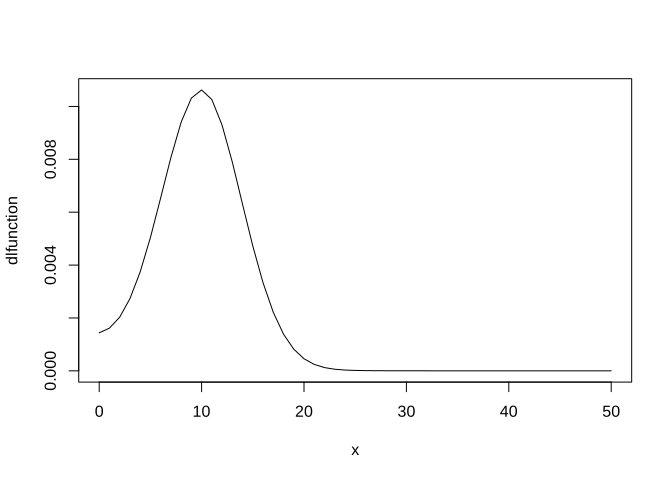
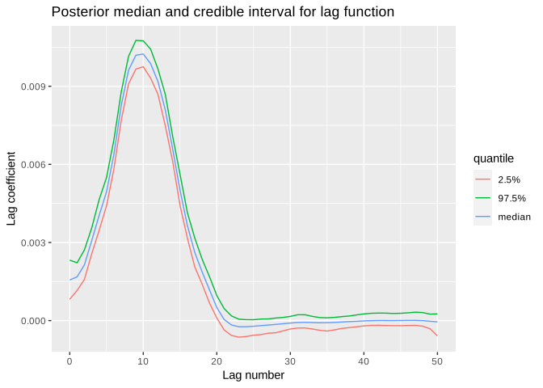

## Overview

`badlm` is a small R package for inferring the temporally delayed
dependence between a predictor and a response variable. It fits the
Bayesian adaptive distributed lag model described in

- Rushworth, A. *Bayesian adaptive distributed lag models.* (2018).
  [arXiv:1801.06670.](https://arxiv.org/abs/1801.06670)

The lag curve is represented by a B-spline basis whose coefficients
receive a first-difference penalty with lag-varying precision. The log
precisions are themselves smoothed by a random walk prior, so the amount
of smoothing adapts to the shape of the lag curve and the maximum lag
can be chosen generously without overfitting. A copy of the paper source
is kept in the `paper/` directory of this repository.

## Installation

To install the development version of the package, use

``` r
devtools::install_github("alastairrushworth/badlm")

# load the package
library(badlm)
```

## `badlm` example

Generate a distributed lag function

``` r
# a nice distributed lag function - hump
x          <- 0:50
dlfunction <- -0.1 + (0.01*exp(-0.2*x) + exp(dnorm(x, sd = 4, mean = 10))) / 10

plot(x, dlfunction, type = "l")
```

<!-- -->

Generate predictor and response under the distributed lag function

``` r
# exposure is an AR(1) process
expose        <- arima.sim(model = list(ar = 0.5), n = 500, sd = 0.1)
expose        <- (expose - mean(expose)) / sd(expose)
lag_mat       <- lag_matrix(expose, p = 50)
deaths.sig    <- lag_mat %*% dlfunction
deaths        <- deaths.sig + rnorm(450, sd = 0.01)
```

Try to recover the distributed lag function. The first half of the
iterations is discarded as burn-in by default; Metropolis proposals are
tuned only during that period.

``` r
dlm_est <- badlm(x = expose, y = deaths, 
           nlag = 50, k = 30, samples = 10000)
```

The fitted object holds pointwise posterior summaries of the lag curve,
the posterior draws of the curve itself, and draws of the effective
degrees of freedom of the fit.

``` r
head(dlm_est$coefs)
```

    ## # A tibble: 6 x 4
    ##     lag    beta   upper    lower
    ##   <int>   <dbl>   <dbl>    <dbl>
    ## 1     0 0.00156 0.00232 0.000818
    ## 2     1 0.00168 0.00222 0.00116 
    ## 3     2 0.00214 0.00272 0.00158 
    ## 4     3 0.00308 0.00357 0.00257 
    ## 5     4 0.00404 0.00465 0.00347 
    ## 6     5 0.00494 0.00549 0.00440

``` r
mean(dlm_est$ed)
```

    ## [1] 13.03209

Plot the resulting lag curve

``` r
plot_lagcurve(dlm_est)
```

<!-- -->
