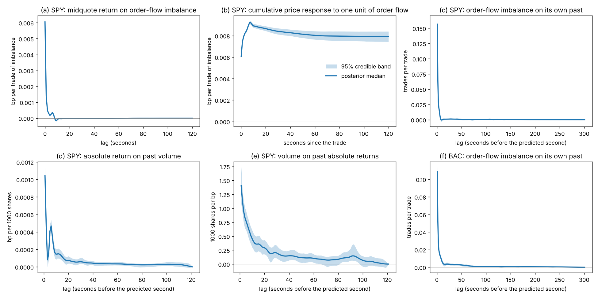
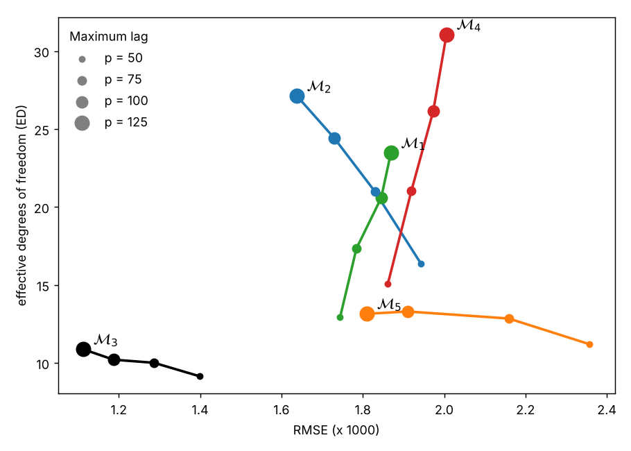
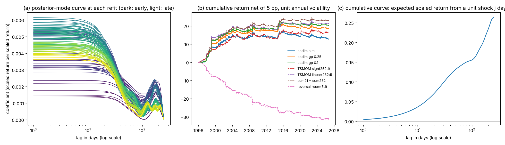
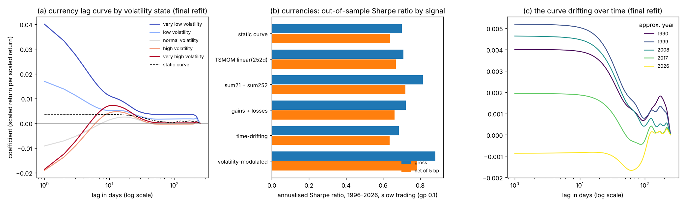

# badlm

Bayesian adaptive distributed lag models in Python.

`badlm` infers the temporally delayed dependence between an exposure series
and a response. It implements the model of

- Rushworth, A. (2018). *Bayesian adaptive distributed lag models.*
  [arXiv:1801.06670](https://arxiv.org/abs/1801.06670). A revised copy of the
  paper source lives in [`paper/`](paper/).

The lag curve is represented by a B-spline basis whose coefficients receive a
first-difference penalty with **lag-varying precision**; the log precisions are
themselves smoothed, so the amount of smoothing adapts to the shape of the curve
and the maximum lag can be chosen generously without overfitting.

This version is a complete rewrite of the original R package. The spline
coefficients are integrated out analytically and the remaining low-dimensional
posterior is sampled with the No-U-Turn Sampler (via NumPyro and JAX), which
removes the funnel between the curve and its smoothing parameters that slowed
the original Gibbs/Metropolis scheme.

## Installation

```bash
pip install git+https://github.com/alastairrushworth/badlm
```

Python 3.10 or later; depends on NumPy, SciPy, JAX, NumPyro and matplotlib.
Optional extras: `pip install "badlm[arviz,pandas]"`.

## Quick start

```python
import numpy as np
from badlm import BADLM, readme_lag_curve, simulate_dlm

# a 'hump' lag curve over 50 lags and data simulated from it
truth = readme_lag_curve(50)
x, y = simulate_dlm(truth, n=500, standardize_x=True, ar_eps=0.0, sd_eps=0.01, seed=2018)

model = BADLM(nlag=50, k=30)               # adaptive model, exact zero constraint at lag 50
model.fit(x, y, samples=1000, warmup=1000, chains=4, seed=1)
print(model.summary())
model.plot(truth=truth)
```


The fitted object exposes the posterior draws of the lag curve on the original
scale (`model.lag_curve_`, shape `(chains, draws, nlag + 1)`) and a set of derived
quantities:

```python
model.lag_curve_summary()        # median and 95% band per lag (to_dataframe() available)
model.cumulative_effect()        # total effect of a unit change in x
model.peak_lag()                 # posterior distribution of the lag with largest effect
model.effective_lag_length()     # lag beyond which the curve is effectively zero
model.effective_df()             # effective degrees of freedom of the fitted curve
model.diagnostics()              # R-hat, bulk ESS, divergent transitions
model.predict(x_new)             # posterior predictive mean / response
model.to_arviz()                 # arviz.InferenceData for further analysis
```

Adaptive versus non-adaptive smoothing on the same data (`tau_model='constant'`
is model M1 of the paper; the default `'rw'` is M3):


## Model options

```python
BADLM(
    nlag=50,                 # maximum lag p
    k=None,                  # B-spline functions; default ceil(2(p + 1)/3)
    tau_model="rw",          # 'rw' | 'basis' | 'monotone' | 'horseshoe' | 'constant'
    end_constraint="zero",   # 'zero' | 'zero_slope' | 'none'
    lag_scale="linear",      # 'linear' | 'log' knot spacing in lag
    family="gaussian",       # 'gaussian' | 'poisson' | 'negbin'
    ar1=False,               # AR(1) errors (Gaussian family)
    intercept=True,
    standardize=True,        # internal standardisation; results on the original scale
    sampler="nuts",          # 'nuts' | 'gibbs' | 'laplace'
    priors=Priors(),         # hyperparameters, see badlm.priors.Priors
    modifier_k=None,         # B-splines in a modifier variable: curve becomes a surface
)
```

`nlag` may also be a list, one entry per column of `x`, for several exposures
with separate curves; `fit` takes `weights` and `modifier` (see the extensions
section below).

**Priors on the log precisions.** `'rw'` is the random walk of the paper with
penalised-complexity (exponential) priors on its scale and on the standard
deviation implied by its level, so the model shrinks towards the non-adaptive
fit unless the data ask for adaptivity, and the precision cannot drift to
numerically meaningless values once the data stop informing it. `'basis'` represents the log precisions with a handful
of B-splines, `'monotone'` forces smoothing to increase with lag, `'horseshoe'`
uses independent local shrinkage of each difference, and `'constant'` is the
non-adaptive model.

**End constraints.** The curve can be forced to zero at the maximum lag, or to
zero with zero slope, by projecting the coefficients onto the constraint null
space; no tuning parameter is involved and the closed-form generalised
determinant used in the likelihood is unchanged.

**Samplers.** `'nuts'` integrates the coefficients out and samples the log
precisions, error variance and AR(1) coefficient with NUTS; each likelihood
evaluation costs O(k^3) irrespective of the series length because only
sufficient statistics are used. Chains start at the Laplace mode and use a
dense mass matrix by default (`dense_mass=False` switches it off). `'gibbs'` is a
Gibbs sampler with slice updates and interweaving, kept as an independent check
of the NUTS implementation. `'laplace'` draws from a Gaussian approximation at
the mode and takes a few seconds.

**Other families.** Poisson and negative binomial responses use a non-centred
parameterisation of the coefficients and NUTS on the full posterior; an
`offset` can be supplied to `fit`. Additional linear covariates are passed as
`covariates`.

**Performance note.** JAX runs each fit on all available cores, and two JAX
processes on one machine slow each other down far more than they share: run
simulation studies in one process, or start each worker with
`XLA_FLAGS=--xla_cpu_multi_thread_eigen=false` and
`intra_op_parallelism_threads=1` so that each is single-threaded. Each fit
compiles its own executables and releases them afterwards
(`clear_jax_cache=True`).

## Examples with real data

Two scripts apply the model to public data, downloaded on first use into
`examples/data/`.

**Stock market data** (`python examples/stocks.py`). Prices are transformed to
percentage log returns, `r_t = 100 log(P_t / P_{t-1})`, for the S&P 500, Apple
and the VIX over 2007 to 2016, and four lag curves are fitted with the default
settings:


- *(a)* Next-day S&P 500 return on the previous 20 days' returns: a short-lived
  reversal, -0.10 (95% interval -0.15 to -0.06) per percentage point at lag one and zero within a week, with
  a cumulative effect of -0.23 (-0.42 to -0.03) and 4.7 effective degrees of freedom.
- *(b)* The same for Apple: indistinguishable from zero everywhere with 1.7
  effective degrees of freedom. The adaptive smoother reports an absence of
  structure rather than inventing it.
- *(c)* Daily change in log VIX on the same day's and the previous 60 days' S&P
  500 returns: implied volatility moves -4.1 (-4.2 to -3.9) per cent for each percentage
  point of index return on the same day, rebounds slightly over the following week,
  and shows nothing beyond about ten days.
- *(d)* Log absolute return on its own past over 100 days: volatility
  clustering, strongest at lags two to three, decaying over about a month and
  small but mostly positive thereafter, with a cumulative elasticity of 0.84
  (0.75 to 0.94) described by 7.9 effective degrees of freedom.

**Intraday microstructure of SPY** (`python examples/microstructure.py`, needs
pandas on the first run). Every trade and quote for SPY and BAC on 7 to 11
October 2013, from the sample data in the QuantConnect Lean repository, reduced
to one-second series: midquote returns in basis points from the best bid and
offer of the four most active venues, order-flow imbalance (buyer- minus
seller-initiated trades, signed against the prevailing midquote), volume and
spread. Lags are formed within each day (`groups=day`) and B-splines of time of
day absorb the intraday pattern.



- *(a, b) Price impact.* One more buy than sell trade in a second moves the
  midquote by 0.0061 bp in that second. The response keeps building for about
  seven seconds, to 0.0093 bp, and then about 15% of it decays away over the
  next minute, leaving a permanent impact of 0.0079 bp (0.0074 to 0.0084).
  The decay is the transient component of impact that microstructure models
  describe with a propagator; here its shape is estimated rather than assumed.
- *(c, f) Memory of order flow.* The imbalance one second earlier predicts
  the current imbalance with coefficient 0.16 for SPY and 0.11 for BAC, but
  the tail is what matters: the coefficients over the following five minutes
  sum to 0.38 for SPY and 0.57 for BAC, and BAC's curve stays positive to
  about 100 s. Order flow in the large-tick stock is more persistent, as order
  splitting in a deep queue predicts.
- *(d) Volatility after volume.* A thousand shares traded a second earlier
  raise the next second's absolute return by 0.001 bp, decaying over about a
  minute with a secondary bump at six to seven seconds, the time the price
  takes to absorb order flow in (b).
- *(e) Volume after volatility.* One basis point of absolute return attracts
  about 1,400 extra shares in the next second and roughly 22,000 over the
  following two minutes.

Each curve uses between 8 and 12 effective degrees of freedom for 120 to 300
lags; all have R-hat at or below 1.03.

**Air pollution and mortality in Chicago** (`python examples/chicago.py`). Daily
deaths in Chicago from 1987 to 2000 on 40 lags of PM10, adjusting for trend and
season, weekday, temperature and dew point, with AR(1) errors; coefficients are
percentage changes in deaths per 10 µg/m³. The data are the `chicagoNMMAPS`
set from the dlnm R package, included in the repository.


- All-cause deaths rise by 0.15% per 10 µg/m³ on the day of exposure (-0.02 to
  0.36) and fall by a similar amount around a week later, where the band lies
  below zero, so the cumulative effect over 40 days is indistinguishable from
  zero: -0.20% (-1.30 to 0.85). Deaths are brought forward by a few days rather
  than added, the "mortality displacement" pattern discussed in the paper, and
  the lag curve shows it directly without any lag structure specified in
  advance. The curve uses about five effective degrees of freedom.
- Cardiovascular deaths show the same shape with smaller amplitude.
  Respiratory deaths, nine a day, are too few to show anything.

**COVID-19 cases and deaths** (`python examples/covid.py [--negbin]`). Daily US
deaths from June 2020 to March 2021 are regressed, on the log scale, on the
seven-day mean of new cases over the previous 35 days, with weekday indicators
for the reporting pattern and AR(1) errors; the coefficients are elasticities.


The cumulative elasticity is 0.74 (0.66 to 0.81): a 10% rise in cases is followed by about
a 7% rise in deaths, the shortfall from one reflecting the falling case
fatality ratio over the period. The curve peaks at about three weeks and is
back at zero by five, and uses under three effective degrees of freedom. Individual lags are poorly identified because the
smoothed case series is collinear across lags: the data determine the total and
the timing, the adaptive prior supplies the smoothness. Deaths reported on
Tuesday to Friday are about 2.5 times Sunday's. A negative binomial model of
the raw counts (`--negbin`, dashed) agrees on the total, 0.73 (0.68 to 0.77),
and on the peak, but its sampler did not converge properly (R-hat 1.4 and many
divergent transitions): the dependence between the curve and its smoothing
parameters that the Gaussian model integrates out remains in a count model.
Treat count models with highly collinear lags as work in progress and prefer
the Gaussian log-scale model when counts are large.

## Validation

The test suite (`pytest`) checks the collapsed likelihood against brute-force
Gaussian marginals, including AR(1) errors; the closed-form generalised
determinants; a Geweke "getting it right" test of the Gibbs sampler; agreement
between the NUTS, Gibbs and Laplace fits; and recovery of known lag curves for
every prior, constraint and family. `pytest -m slow` additionally runs a
simulation-based calibration check of the NUTS sampler.

## Simulation study

`examples/simulation_study.py` re-runs the paper's simulation study with the
collapsed sampler. It compares the adaptive model (M3) with the non-adaptive
model (M1), a Bayesian ridge penalty increasing with lag (M2, Muggeo 2008), a
Bayesian P-spline with an added ridge (M4, Obermeier et al. 2015) and
log-spaced knots chosen by AIC (M5, Gasparrini et al. 2010) on five lag-curve
shapes, and then examines how each model's effective degrees of freedom and
error change as the assumed maximum lag grows from 50 to 125 on a curve that
really has 50 lags. The published curves are not available in closed form, so
`badlm.paper_lag_curves` provides approximations with the same features.

With 50 replicates per lag curve (RMSE scaled by 10^3, squared bias by 10^6,
ED the posterior mean effective degrees of freedom of the lag curve, or the
number of basis functions chosen for M5):

| Lag curve | Summary | M1 | M2 | M3 | M4 | M5 |
|---|---|---|---|---|---|---|
| Delayed peak | RMSE (x10^3) | 1.98 | 2.26 | 1.53 | 2.12 | 2.54 |
| Delayed peak | Bias^2 (x10^6) | 0.50 | 0.48 | 0.40 | 0.52 | 0.52 |
| Delayed peak | ED | 13.32 | 17.86 | 8.84 | 15.48 | 12.32 |
| Decay curve | RMSE (x10^3) | 1.45 | 1.99 | 1.29 | 1.51 | 1.45 |
| Decay curve | Bias^2 (x10^6) | 0.48 | 0.53 | 0.43 | 0.50 | 0.52 |
| Decay curve | ED | 8.80 | 15.32 | 7.04 | 9.38 | 5.28 |
| Flat response | RMSE (x10^3) | 0.59 | 0.62 | 0.59 | 0.70 | 1.35 |
| Flat response | Bias^2 (x10^6) | 0.32 | 0.08 | 0.32 | 0.17 | 0.51 |
| Flat response | ED | 2.57 | 4.29 | 2.52 | 4.63 | 4.98 |
| Displacement | RMSE (x10^3) | 1.95 | 2.14 | 1.61 | 2.11 | 2.36 |
| Displacement | Bias^2 (x10^6) | 0.50 | 0.37 | 0.42 | 0.48 | 0.51 |
| Displacement | ED | 13.02 | 16.58 | 9.29 | 15.33 | 10.94 |
| Sharp peak | RMSE (x10^3) | 2.84 | 2.23 | 1.29 | 2.92 | 1.69 |
| Sharp peak | Bias^2 (x10^6) | 0.54 | 0.35 | 0.35 | 0.55 | 0.51 |
| Sharp peak | ED | 14.00 | 15.08 | 5.65 | 16.06 | 6.56 |

The adaptive model has the lowest RMSE under every non-null curve, by 11 to 24
per cent relative to the best competitor, while using between a fifth and three
fifths fewer effective degrees of freedom than the single-penalty P-spline M1;
under the flat response M1 and M3 are indistinguishable and neither invents
structure. The log-knot model M5 is competitive when the effect sits at short
lags (decay curve, sharp peak) and worst when it does not.

Fitting the displacement curve, which has 50 lags, with maximum lags of 50 to
125 (20 replicates; RMSE over all p + 1 lags, scaled by 10^3):

| Maximum lag p | M1 RMSE | M2 RMSE | M3 RMSE | M4 RMSE | M5 RMSE | M1 ED | M2 ED | M3 ED | M4 ED | M5 ED |
|---|---|---|---|---|---|---|---|---|---|---|
| 50 | 1.74 | 1.94 | 1.40 | 1.86 | 2.36 | 12.9 | 16.4 | 9.1 | 15.1 | 11.2 |
| 75 | 1.78 | 1.83 | 1.29 | 1.92 | 2.16 | 17.3 | 21.0 | 10.0 | 21.0 | 12.8 |
| 100 | 1.85 | 1.73 | 1.19 | 1.97 | 1.91 | 20.6 | 24.4 | 10.2 | 26.1 | 13.3 |
| 125 | 1.87 | 1.64 | 1.11 | 2.01 | 1.81 | 23.5 | 27.1 | 10.9 | 31.1 | 13.2 |

The adaptive model's effective degrees of freedom barely move as the assumed
maximum lag grows, and its RMSE falls because the extra lags are estimated as
zero; M1, M2 and M4 spend their extra basis functions on noise in the lags that
do not matter.



Run `python examples/simulation_study.py --reps 50 --reps2 20` to reproduce
(about six hours on four cores); results, the LaTeX table and the figures are
written to `paper/results`, `paper/tables` and `paper/figures`.

## Extensions for prediction: several exposures, modifiers, weights, tempering

Version 0.3 adds four things to the Gaussian model, all of which keep the
collapsed likelihood (the coefficients are still integrated out and each
likelihood evaluation still costs a Cholesky factorisation of a small matrix).

- **Several exposures.** `BADLM(nlag=[p1, p2, ...])` fits one adaptive lag
  curve per column of `x`, each with its own log precisions, under a
  block-diagonal prior. This is how interactions enter: pass `x` and
  `x * z` as two exposures and the second curve is the lag-varying effect of
  the modifier `z`; pass `max(x, 0)` and `min(x, 0)` for asymmetric responses;
  pass another series for a cross-series lead-lag curve. The summaries,
  `predict`, `plot(exposure=e)` and `lag_curve_summary(exposure=e)` all
  understand the extra curves.
- **A second smoothing dimension.** `BADLM(modifier_k=K)` with
  `fit(..., modifier=z)` makes each curve a surface over lag and a modifier
  variable, represented by a tensor product of the lag basis with `K`
  B-splines in `z`. The adaptive first-difference penalty acts along lag; a
  first-difference penalty with a penalised-complexity prior on its scale acts
  along `z`, so the surface shrinks towards the ordinary curve unless the data
  ask for state dependence. The prior precision is a Kronecker sum and its
  log-determinant comes from the eigenvalues of the two factors, so the
  sampler is unchanged. `z` can be a state variable (volatility, volume),
  `'exposure'` for the lagged exposure itself (the non-linear exposure-lag
  cross-basis of Gasparrini et al., 2010) or `'time'` (a smoothly drifting
  curve). `lag_surface(z)` summarises the surface at chosen modifier values.
- **Observation weights.** `fit(..., weights=w)` multiplies each squared
  residual by `w`, for inverse-variance weighting of heteroskedastic series.
- **A tempered likelihood.** `Priors(temper=T)` divides the log-likelihood by
  `T`. Rows of a panel that are correlated across series, or heteroskedastic,
  carry less evidence than independent Gaussian rows, and the trading
  experiments below show that without this correction the marginal likelihood
  happily spends thirty-odd effective degrees of freedom on wiggles that do
  not survive out of sample. Constant weights cannot do this, because the free
  error variance absorbs them exactly.
- **Log-spaced knots.** `BADLM(lag_scale='log')` places the knots in
  `log(1 + lag)`, which is useful when the curve is expected to change quickly
  at short lags and slowly at long ones.

`badlm.backtest` adds a walk-forward evaluation loop. `FastFitter` compiles
the collapsed posterior once and finds its mode for any window's sufficient
statistics (an L-BFGS run warm-started at the previous window's mode, well
under a second per refit), `walk_forward` refits on an expanding window at a
chosen cadence and returns the out-of-sample predictive mean and variance of
every row, `trade` turns predictions into risk-scaled positions traded fully,
slowly towards the aim (Garleanu and Pedersen, 2013) or with a no-trade band,
`performance` reports gross and net Sharpe ratios, turnover and the
break-even cost, and `deflated_sharpe` adjusts for the number of rules tried.

## Trading experiments

The scripts `examples/trading_*.py` ask whether an adaptive lag curve can be
turned into a trading signal that survives costs, using daily data that are
free to download: eleven US equities and ETFs 1998 to 2021 (QuantConnect Lean
sample data, split- and dividend-adjusted), eighteen floating exchange rates
against the dollar 1990 to 2026 (Federal Reserve H.10), spot WTI and Brent, and
gold (`examples/_markets.py` documents the sources and the cleaning). Returns
are divided by an ex-ante volatility (a 30-day half-life EWMA lagged a day)
and winsorised at five standard deviations; the response is the next day's
scaled return and the exposure is the scaled return itself, so the lag curve
is the whole linear return-on-past-returns relation at a daily resolution.
Everything reported is out of sample: the curve is re-estimated every 63
trading days on an expanding window starting in 1996, and each day's
prediction uses only earlier data. Positions are the predictive mean divided
by the predictive variance and by volatility, so that every asset carries the
same ex-ante risk, and are either set to that aim each day or moved a tenth of
the way towards it ("slow", the Garleanu-Pedersen rule). Costs are
proportional to notional traded; one to two basis points is realistic for
major currency forwards and futures, five for the rest. Sharpe ratios are
annualised and the comparison rules use the same rows, the same
volatility scaling and the same trading rules: time-series momentum
(Moskowitz, Ooi and Pedersen, 2012) as the sign or the mean of the past 252
days, and a two-horizon rule, the sum of the past 21 days plus the sum of the
past 252 days.

**Calibrating the evidence.** The first lesson came from the calibration runs
(`--k`, `--scale`, `--temper`): with 84 basis functions and the default priors
the final curve had an in-sample information coefficient of 0.050 and an
out-of-sample one of 0.014, and used about 38 effective degrees of freedom.
Daily returns are far from independent Gaussian rows (the currencies have an
average pairwise correlation of 0.37), the penalised-complexity priors are
uninformative at the scale of return predictability (coefficients of a few
thousandths), and the marginal likelihood therefore pays for wiggles that do
not persist. A prior scale matched to that size (`tau_level_scale=0.001`) and
a tempered likelihood (`temper=10`) bring the in-sample coefficient down to
0.028 and the out-of-sample one up to 0.019, the same as a deliberately coarse
basis of ten functions. All experiments below use 25 basis functions over 250
lags with that prior and temperature.

**1. One pooled curve across assets** (`trading_pooled.py`). The currency
curve is a plateau of about 0.004 (scaled return per scaled return) over
lags one to thirty, decaying to zero by about lag 100, with a small bump at
six to nine months: momentum at every horizon up to a quarter, strongest in
the first month, and no reversal at any lag (figure, panel a). Its level has
fallen over time, from 0.006 in the fits of the late 1990s to 0.0035 now.

| Currencies, 1996-2026, slow trading | IC | Gross SR | Net SR, 2 bp | Net SR, 5 bp | Turnover/yr |
|---|---|---|---|---|---|
| badlm pooled curve | 0.020 | 0.70 | 0.67 | 0.64 | 8 |
| time-series momentum, sign of past year | 0.021 | 0.57 | 0.55 | 0.51 | 5 |
| time-series momentum, mean of past year | 0.021 | 0.71 | 0.69 | 0.67 | 5 |
| past month plus past year | 0.027 | 0.81 | 0.78 | 0.72 | 11 |
| five-day reversal | 0.011 | -0.62 | -0.77 | -0.99 | 45 |

The curve is a profitable signal net of realistic currency costs, with a
deflated Sharpe probability of 0.94 against the three trading rules tried,
but it only matches the one-parameter momentum rule and does not reach the
two-horizon rule. Pooling the equities and commodities in (`--universe all`)
lowers the numbers to 0.66 gross and 0.61 net, and the curve has little to
say about eleven US stocks and ETFs (0.32) or two oil series and gold (0.15),
where momentum rules are equally weak. Profitability is concentrated in time:
the mean yearly net Sharpe ratio is 1.3 for 1996 to 2005, 0.2 for 2006 to
2015 and -0.5 for 2016 to 2026, the well-documented fading of currency trend
following.



**2. A second smoothing dimension** (`trading_modulated.py`). Letting the
curve vary with the asset's own volatility state (log of ex-ante volatility
relative to its expanding median, five B-splines, roughness along the state
shrunk by a penalised-complexity prior) is the extension that works. The
surface in panel (a) of the figure below says that in quiet markets a move is
followed by strong continuation at lags one to ten, while after a volatile
period the first week reverses and only the second and third weeks continue;
the static curve is the average of the two and does neither well. Out of
sample the information coefficient rises from 0.020 to 0.027 and the slow
rule earns a gross Sharpe ratio of 0.88 and 0.78 net of five basis points,
above the two-horizon rule (0.81 and 0.72) and the static curve (0.70 and
0.64); on all 32 series the numbers are 0.84 gross and 0.77 net against 0.66
and 0.61 for the static curve.



**What else was tried.** Gains and losses as separate exposures (losses
continue, gains barely do, no out-of-sample edge), a return-times-volume
exposure for the equities (nothing), a curve drifting with calendar time
(tracks the fading of the plateau but the drift is only known afterwards),
and a two-state hidden Markov regime on the amplitude of the signal (the
states flip almost daily and the rule loses after costs). The reasons and
numbers are in [`notes/research_log.md`](notes/research_log.md); the code was
not kept.

**What to take from this.** Three things made the difference between the
earlier unprofitable attempts and these results: evaluating out of sample
with a cost model and a slow trading rule; calibrating the evidence of a
dependent, heavy-tailed panel so that the adaptive smoother does not overfit;
and giving the curve a second dimension along the volatility state. The pooled curve on its own
rediscovers time-series momentum and nothing more, which is reassuring but
not an edge. The volatility-dependent surface is an edge in this data, with
the usual caveats: one asset class, fifteen daily-rebalanced spot series
standing in for forwards, no carry, no slippage model beyond proportional
costs, a shrinking signal in the last decade, and a handful of design choices
(basis size, prior scale, temperature, trading speed) made with the same
data. Variants of the surface and of the trading rule, and a second batch of
ideas that did not beat it, are logged in
[`notes/research_log.md`](notes/research_log.md). Run
`python examples/trading_summary.py` to redraw the figure from
`paper/results/trading_*.json`.

## Citation

```
@article{rushworth2018badlm,
  title   = {Bayesian adaptive distributed lag models},
  author  = {Rushworth, Alastair},
  journal = {arXiv preprint arXiv:1801.06670},
  year    = {2018}
}
```
